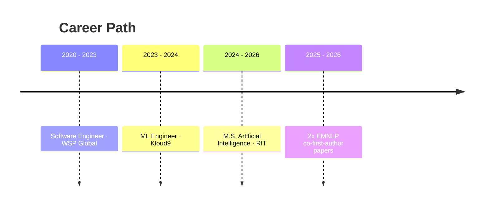

<!-- ===================== HEADER ===================== -->

  

  

  
  
  
  
  

📍 Sunnyvale, CA &nbsp;·&nbsp; 🎓 M.S. Artificial Intelligence, RIT &nbsp;·&nbsp; 🔎 Open to ML / NLP / Research Engineer roles

---

## 👋 About Me

I'm a research engineer working where **responsible NLP** meets **production engineering**.
I build LLM-as-a-judge pipelines, validate them against human experts, and ship ML systems that hold up on real, large-scale data.

Before research, I spent 4+ years building ML and automation systems in industry. That's why I care about evaluation that is rigorous, reproducible, and actually usable.

> **Currently interested in:** LLM evals · AI safety · socially aligned NLP · large-scale data systems

---

## ⚡ Selected Impact

<table>
  <tr>
    <td align="center" width="33%">
      <h3>6.7M</h3>
      parliamentary speeches analyzed with an LLM-as-a-judge pipeline
    </td>
    <td align="center" width="33%">
      <h3>κ = 0.711</h3>
      LLM agreement with human consensus (human–human κ = 0.644)
    </td>
    <td align="center" width="33%">
      <h3>3 hrs → 20 min</h3>
      per-batch analysis runtime in a production ML pipeline
    </td>
  </tr>
</table>

---

## 📄 Publications

| | Paper | Venue | Role | Links |
|:-:|---|---|---|---|
| 🏛️ | **Two Centuries of Sexism in British Parliament:** A Computational Analysis of Women's Representation in the Hansard Corpus | EMNLP 2026 · Main | Co-first author | [Paper]({{EMNLP_2026_PAPER_URL}}) · [arXiv]({{ARXIV_URL}}) · [Code](https://github.com/mandira-sawkar/Two-Centuries-of-Sexism) |
| 🧩 | **LPI-RIT at LeWiDi-2025:** Improving Distributional Predictions via Metadata and Loss Reweighting with DisCo | NLPerspectives Workshop · EMNLP 2025 | Co-first author | [Paper](https://aclanthology.org/2025.nlperspectives-1.17/) · [Code](https://github.com/mandira-sawkar/LeWiDi3_NLPeerespectives_2025) |

📚 Full list on <a href="https://scholar.google.com/citations?hl=en&user=lbaywYoAAAAJ">Google Scholar</a>

---

## 🔬 Featured Work

<table>
  <tr>
    <td width="50%" valign="top">
      
      <h3>🏛️ Hansard Sexism Analysis</h3>
      <b>Problem:</b> Measure sexist rhetoric across 200 years of UK parliamentary debate. 
      <b>Built:</b> Psychology-grounded taxonomy, 300-speech human validation set, cross-model LLM judging. 
      <b>Result:</b> Sexism in 54% of anti-suffrage vs. 21% of pro-suffrage speeches.  
      
      
    </td>
    <td width="50%" valign="top">
      
      <h3>🧩 Disagreement-Aware Modeling</h3>
      <b>Problem:</b> Single labels erase minority perspectives in subjective tasks. 
      <b>Built:</b> Extended DisCo with annotator-metadata embeddings and task-aligned losses. 
      <b>Result:</b> ~40% lower soft-label distance on CSC and Paraphrase.  
      
      
    </td>
  </tr>
  <tr>
    <td width="50%" valign="top">
      <h3>⚖️ LLM-as-a-SupremeCourt-Judge</h3>
      Evaluated 200+ U.S. Supreme Court cases to measure how panel size, prompting strategy, and ideology personas shift LLM–judge alignment.  
      
    </td>
    <td width="50%" valign="top">
      <h3>🕵️ Detecting Deception</h3>
      Logic-gated fact-checking with DistilRoBERTa and contradiction detection. Validated on 7,200+ claims at 83% accuracy, with selective overrides for low-confidence predictions.  
      
    </td>
  </tr>
</table>

<b>🗂️ More projects</b>

 

| Project | What it does | Highlight |
|---|---|---|
| [Two Centuries of Sexism](https://github.com/mandira-sawkar/Two-Centuries-of-Sexism) | LLM-as-a-Judge framework featuring 1.2 million historic parliamentary debates| LLM Evals |
| [Learning With Disagreements](https://github.com/mandira-sawkar/LeWiDi3_NLPerspectives_2025) | Modelling annotators and non-binary labels | Multilayer Perceptron, NLI |
| [LLM-as-a-SupremeCourt-Judge](https://github.com/mandira-sawkar/LLM-as-a-SupremeCourt-Judge) | LLM-as-a-Judge framework evaluating 200 Supreme Court cases | LLM Classification |
| [Detecting Deception](https://github.com/mandira-sawkar/ Intelligent-Systems-for-Fighting-Misinformation) | Fake news detection with DistilRoBERTa with logic-gated ML overrides | RoBERTa + Logic gates |

---

## 💼 Experience

<b>🧠 Machine Learning Engineer — Kloud9</b> &nbsp;·&nbsp; Apr 2023 – Jul 2024

 

- Built a ghost-inventory prediction pipeline across 50+ features and multimillion-row datasets: **92% accuracy**, **10% fewer stock discrepancies**.
- Cut per-batch analysis runtime from **3 hours to 20 minutes**.
- Reduced production deployment time by **~80%** with data-engineering and business teams.
- Mentored **5+ interns** in feature engineering, PySpark, and ML evaluation, leading to **3 full-time hires**.

<b>⚙️ Software Engineer — WSP Global</b> &nbsp;·&nbsp; Oct 2020 – Apr 2023

 

- Built a CLI tool automating onboarding for **60,000+ employees annually**, saving **2.5 human-months per year**.
- Cut operations overhead by **71%** with an automated project-archival pipeline.
- Validated **80,000+ employee records monthly** with a Python and Pandas data-quality system.

<b>🎓 Education</b>

 

- **M.S. Artificial Intelligence** — Rochester Institute of Technology, May 2026 · GPA 3.7
  Thesis: *Two Centuries of Sexism in British Parliament* · Advisor: Dr. Ashiqur R. KhudaBukhsh
- **PG Certification, Software Engineering for Data Science** — IIIT Hyderabad, 2023 · Distinction
- **Bachelor of Computer Applications** — IGNOU, 2020 · First Class

---

## 🛠️ Toolkit

**Languages**

  

**ML · NLP · LLMs**

  
   
  
  
  
  
  

**Data · Cloud · Deployment**

  
   
  
  
  
  
  

---

## 🏆 Recognition

- 🥇 **1st place of ~60 presentations** — RIT Graduate Showcase 2025, *AI Alignment in Criminal Justice*
- 🖼️ **Poster** — RIT Graduate Showcase 2025, *LLM-as-a-SupremeCourt-Judge*

---

## 🤝 Let's Connect

I'm happy to talk about LLM evaluation, AI safety, responsible NLP, or research engineering roles.

  <a href="mailto:mandirasawkar@gmail.com">📧 Email</a> &nbsp;·&nbsp;
  <a href="https://www.linkedin.com/in/mandira-sawkar">💼 LinkedIn</a> &nbsp;·&nbsp;
  <a href="https://mandira-sawkar.github.io/">🌐 Portfolio</a> &nbsp;·&nbsp;
  <a href="https://scholar.google.com/citations?hl=en&user=lbaywYoAAAAJ">📚 Scholar</a>

<!-- ===================== FOOTER ===================== -->

  

