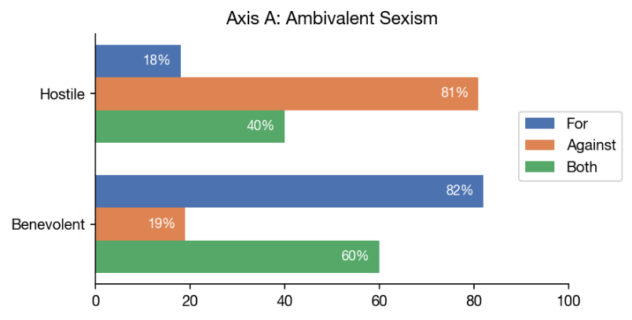
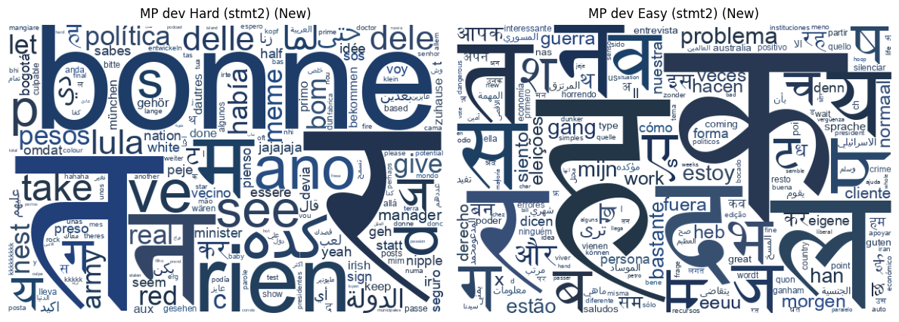

<!-- ===================== HEADER ===================== -->

  

  
  
  
  
  

Sunnyvale, CA &nbsp;·&nbsp; M.S. Artificial Intelligence, RIT

---

## About Me

I'm a research engineer working where responsible NLP meets production engineering.
I build LLM-as-a-judge pipelines, validate them against human experts, and ship ML systems that hold up on real, large-scale data.

Before research, I spent 4+ years building ML and automation systems in industry. That's why I care about evaluation that is rigorous, reproducible, and actually usable.

**Currently interested in:** LLM evals · AI safety · socially aligned NLP · large-scale data systems

---

<!-- ## Selected Impact

<table>
  <tr>
    <td align="center" valign="top" width="33%">
      <h3>6.7M</h3>
      parliamentary speeches analyzed with an LLM-as-a-judge pipeline
    </td>
    <td align="center" valign="top" width="33%">
      <h3>κ = 0.711</h3>
      agreement with expert consensus (human–human κ = 0.644)
    </td>
    <td align="center" valign="top" width="33%">
      <h3>3 hrs → 20 min</h3>
      per-batch analysis runtime in a production ML pipeline
    </td>
  </tr>
</table>

--- -->

## Publications

| Paper | Venue | Role | Links |
|---|---|---|---|
| **Two Centuries of Sexism in British Parliament:** A Computational Analysis of Women's Representation in the Hansard Corpus | EMNLP 2026 · Main | Co-first author | [Paper]({{EMNLP_2026_PAPER_URL}}) · [arXiv]({{ARXIV_URL}}) · [Code](https://github.com/mandira-sawkar/Two-Centuries-of-Sexism) |
| **LPI-RIT at LeWiDi-2025:** Improving Distributional Predictions via Metadata and Loss Reweighting with DisCo | NLPerspectives Workshop · EMNLP 2025 | Co-first author | [Paper](https://aclanthology.org/2025.nlperspectives-1.17/) · [Code](https://github.com/mandira-sawkar/LeWiDi3_NLPeerespectives_2025) |

Full list on <a href="https://scholar.google.com/citations?hl=en&user=lbaywYoAAAAJ">Google Scholar</a>

---

## Featured Work

<table>
  <tr>
    <td width="50%" valign="top">
      <!--  -->
      <h3>Hansard Sexism Analysis</h3>
      <b>Problem:</b> Measure sexist rhetoric across 200 years of UK parliamentary debate. 
      <b>Built:</b> Psychology-grounded taxonomy, 300-speech human validation set, cross-model LLM judging. 
      <b>Result:</b> Sexism in 54% of anti-suffrage vs. 21% of pro-suffrage speeches.  
      
      
    </td>
    <td width="50%" valign="top">
      <!--  -->
      <h3>Disagreement-Aware Modeling</h3>
      <b>Problem:</b> Single labels erase minority perspectives in subjective tasks. 
      <b>Built:</b> Extended DisCo with annotator-metadata embeddings and task-aligned losses. 
      <b>Result:</b> ~40% lower soft-label distance on CSC and Paraphrase.  
      
      
    </td>
  </tr>
  <tr>
    <td width="50%" valign="top">
      <h3>LLM-as-a-SupremeCourt-Judge</h3>
      Evaluated 200+ U.S. Supreme Court cases to measure how panel size, prompting strategy, and ideology personas shift LLM–judge alignment.  
      
    </td>
    <td width="50%" valign="top">
      <h3>Detecting Deception</h3>
      Logic-gated fact-checking with DistilRoBERTa and contradiction detection. Validated on 7,200+ claims at 83% accuracy, with selective overrides for low-confidence predictions.  
      
    </td>
  </tr>
</table>

<b>More projects</b>

 

| Project | What it does | Highlight |
|---|---|---|
| [Beyond Hallucinations](https://github.com/mandira-sawkar/Beyond-Hallucinations-Multi-Agent-Fact-Checking) | Theoretical framework where multiple LLM agents reach verifiable answers through debate and consensus | Agentic AI |
| [AI Alignment in Criminal Justice](https://github.com/mandira-sawkar/AI-Alignment-in-Criminal-Justice) | Optimization and game-theory model for fair jury selection and deliberation | 1st of ~60, RIT Graduate Showcase |
| [Parking Ticket Classifier](https://github.com/mandira-sawkar/Interpretable-Parking-Ticket-Location-Classifier) | Spark ML Random Forest predicting NYC police precinct | 98% accuracy |
| [Shipping Status Classifier](https://github.com/mandira-sawkar/Product-Shipping-Status-Classifier) | Predicts supply-chain delays with PCA / LDA | 97% accuracy |
| [Cancer Detection Microservice](https://github.com/mandira-sawkar/Cancer-Detection-as-a-Microservice) | Voting classifier served via Flask in Docker | End-to-end deployment |
| [getPaid](https://github.com/mandira-sawkar/getPaid) | PySpark model predicting employee compensation | R² = 0.98 |

---

## Experience

**Milestones**

  

<b>ML Engineer — Kloud9.nyc</b> &nbsp;·&nbsp; Apr 2023 – Jul 2024

 

- Built a ghost-inventory prediction pipeline across 50+ features and multimillion-row datasets: 92% accuracy, 10% fewer stock discrepancies.
- Cut per-batch analysis runtime from 3 hours to 20 minutes.
- Reduced production deployment time by ~80% with data-engineering and business teams.
- Mentored 5+ interns in feature engineering, PySpark, and ML evaluation, leading to 3 full-time hires.

<b>Software Engineer — WSP Global</b> &nbsp;·&nbsp; Oct 2020 – Apr 2023

 

- Built a CLI tool automating onboarding for 60,000+ employees annually, saving 2.5 human-months per year.
- Cut operations overhead by 71% with an automated project-archival pipeline.
- Validated 80,000+ employee records monthly with a Python and Pandas data-quality system.

<b>Education</b>

 

- **M.S. Artificial Intelligence** — Rochester Institute of Technology, May 2026 · GPA 3.7
  Thesis: *Two Centuries of Sexism in British Parliament* · Advisor: Dr. Ashiqur R. KhudaBukhsh
- **PG Certification, Software Engineering for Data Science** — IIIT Hyderabad, 2023 · Distinction
- **Bachelor of Computer Applications** — IGNOU, 2020 · First Class

---

## Toolkit

**Languages**

  
  
  
  
  
  
  

**ML · NLP · LLMs**

  
  
  
  
  
  

  
  
  
  
  
  

**Data Engineering**

  
  
  
  
  
  

**Cloud · Deployment**

  
  
  
  
  
  

---

## Recognition

- **1st place of ~60 presentations** — RIT Graduate Showcase 2025, *AI Alignment in Criminal Justice*
- **Poster** — RIT Graduate Showcase 2025, *LLM-as-a-SupremeCourt-Judge*

---

## Let's Connect

I'm happy to talk about LLM evaluation, AI safety, responsible NLP, or research engineering roles.

  
  
  
  

<!-- ===================== FOOTER ===================== -->

  

